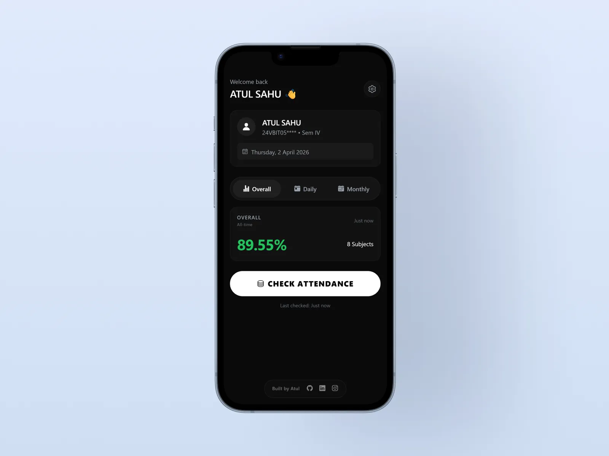

  

  # AttendanceEase v2.0.0

  **Modern Attendance Tracking for St. Xavier’s College, Ranchi**

  
  

  *This repository contains AttendanceEase release builds (APK files) and documentation. It does not include the application source code.*

---

## Features

- **Quick Access:** Check your attendance without navigating the college portal.
- **Attendance Analytics:** View overall, daily, and monthly attendance.
- **Smart Attendance Planner:** Track attendance targets and identify subjects that need attention.
- **Offline Caching:** Access previously loaded data when offline.
- **Modern UI:** Clean, minimal interface with dark mode.
- **Optimized Performance:** Designed for a smooth mobile experience.

---

## Installation

1. **Download:** Get `AttendEase.apk` from the [v2.0.0 Release](https://github.com/AtulSahu778/attendance-app-downloads/releases/tag/v2.0.0).
2. **Allow Installation:** If prompted, enable **Install unknown apps** for your browser or file manager in Android Settings.
3. **Install:** Open the downloaded APK and tap **Install**.
4. **Launch:** Open AttendanceEase and sign in.

> **Security:** Download the APK only from this repository's official release page.

---

## Screenshots

| Attendance Overview | Attendance Analytics | Attendance Planner |
|:---:|:---:|:---:|
|  |  |  |

| Additional View 1 | Additional View 2 |
|:---:|:---:|
|  |  |

---

## Release Information

- **Version:** 2.0.0
- **Platform:** Android
- **Format:** APK
- **Institution:** St. Xavier’s College, Ranchi

See the [Releases page](https://github.com/AtulSahu778/attendance-app-downloads/releases) for available versions and release notes.

---

## Support

- **Report an issue:** Use the feedback system within the app.
- **Contact:** [sahuatul2005@gmail.com](mailto:sahuatul2005@gmail.com)

---

  Built by Atul Sahu
   
  AttendanceEase is an independent project and is not officially affiliated with or endorsed by St. Xavier’s College, Ranchi.

